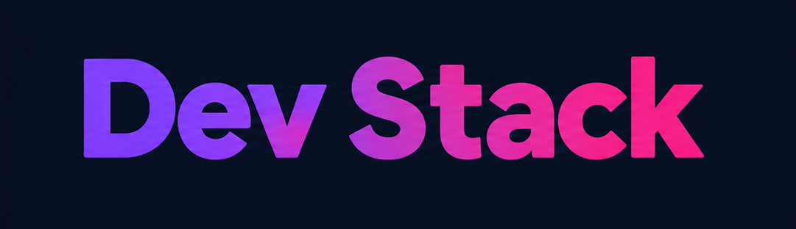

<p align="center">
  

<h1 align="center">Your one-stop solution to scaffolding high-voltage projects</h1>

**Dev Stack** is a web application that allows developers to explore different technologies and build their own personalized technology stack. Users can browse technologies by category, add technologies to their stack, remove individual technologies, or clear the entire stack.

## ✨ Features

- 🧰 **Build Your Own Tech Stack** — Browse available technologies and add them to your personal stack.
- 📱 **Responsive UI** — Designed to work smoothly in mobile and desktop screen sizes.
- 🔔 **Interactive Notifications** — Uses React-Toastify to provide feedback when technologies are added, removed, duplicated, or when the entire stack is cleared.

## 🛠️ Technologies Used

* **React.js** — Building the user interface and managing components.
* **TypeScript** — Providing type safety and better development experience.
* **Tailwind CSS** — Styling and responsive layout.
* **DaisyUI** — Reusable UI components and styling utilities.
* **React-Toastify** — Displaying toast notifications.
* **JSON** — Storing and loading technology data.
* **Vite** — Development server and build tool.

## ⚡ Key Functionality

### Technology Selection

Each technology is displayed as a card containing its icon, name, description, category, difficulty level, rating, and an **Add to Stack** button.

After a technology is added, its button becomes disabled and displays:

```text
✓ Added to Stack
```

### Duplicate Prevention

The same technology cannot be added to the stack more than once. Attempting to add an already-selected technology displays a warning toast.

### One Technology Per Category

The stack allows only **one technology from each category**. This keeps the selected stack organized and prevents multiple technologies from being selected from the same category.

### Stack Management

Users can:

* Add technologies to their stack.
* Remove individual technologies.
* Remove all selected technologies at once.
* See the current number of selected technologies.
* Receive toast notifications for stack actions.

### Loading State

Technology data is loaded from a local JSON file using `useEffect`. A loading state is displayed while the data is being fetched.

### Shared Gradient Theme

The application's primary gradient follows an **orange → pink → violet** theme. The gradient is defined centrally so the brand name, hero heading, and primary buttons can share the same visual theme.

## 📌 Installation & Setup

### 1. Clone the repository

```bash
git clone <your-repository-url>

cd dev-stack-builder

npm install

npm run dev
```

The application will then be available at the local URL provided by Vite.

---

## 📦 Build for Production

To create a production build:

```bash
npm run build
```

To preview the production build locally:

```bash
npm run preview
```
